<p align="center">
  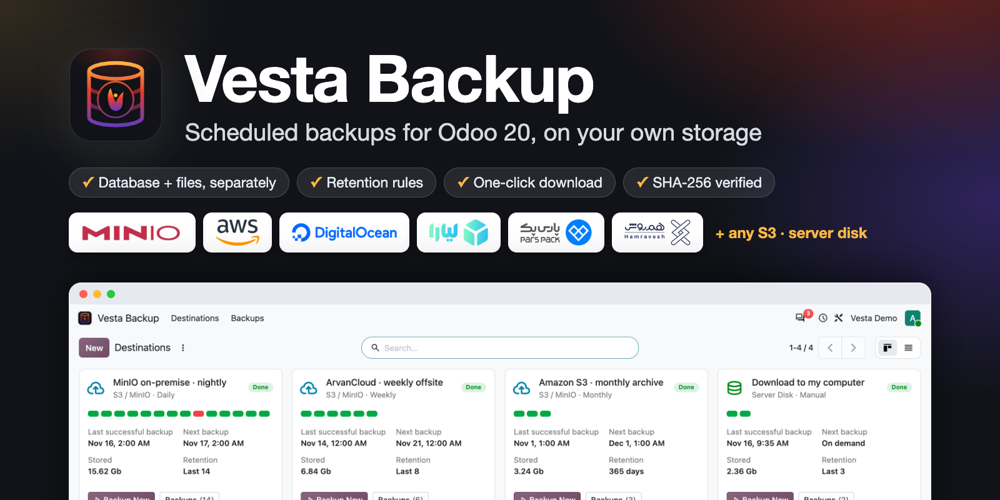
</p>

<p align="center">
  
  
  
  
</p>

<p align="center">
  <a href="#en">English</a> · <a href="#fa">فارسی</a> ·
  <a href="#quick-start">Quick start</a> · <a href="#restore">Restore</a> · <a href="#faq">FAQ</a>
</p>

---

<div id="en">

## Never lose an Odoo database again

**Vesta Backup** backs up your Odoo 20 database **and** its files every night, every week or every hour, to
the storage *you* own: a MinIO on your own network, AWS S3, DigitalOcean Spaces, Liara, ParsPack,
Hamravesh, ArvanCloud, Cloudflare R2 or any other S3-compatible storage, or the server's own disk. Old backups are pruned for you, every file is checksummed, and any backup is one click
away from your laptop.

No cron scripts, no SSH, no forgetting. Open the app, see at a glance which destinations are healthy, and
press **Backup Now** whenever you are about to do something risky.

<p align="center">
  <b>Works with</b><br><br>
  
</p>

<p align="center">
  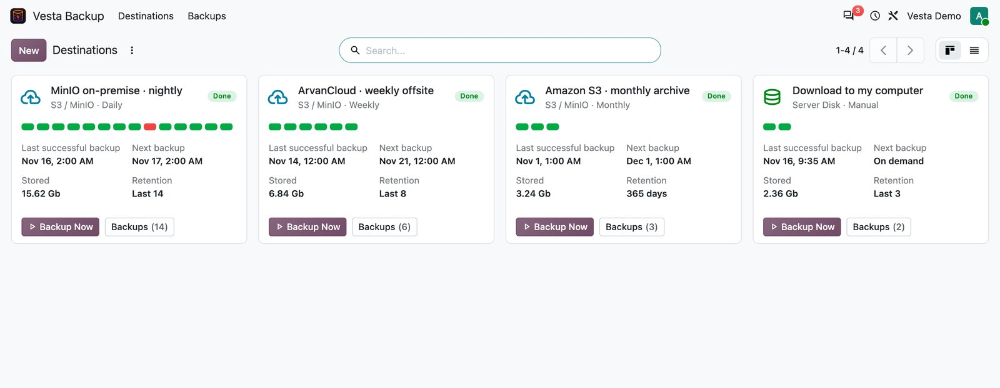
</p>

### Why teams switch to Vesta Backup

| | |
|---|---|
| 🗄️ **Database and files, separately** | A compressed `pg_dump` (`.dump`), the filestore as `.tar.gz` and a manifest. Restore just the database, or just the attachments. |
| 📦 **Or one Odoo zip** | The exact format of the Odoo database manager: restore it from `/web/database/manager` in two clicks. |
| ☁️ **Any S3, including your own MinIO** | MinIO, AWS S3, DigitalOcean Spaces, Liara, ParsPack, Hamravesh, ArvanCloud, Cloudflare R2, Wasabi… Your own endpoint, path or virtual-host addressing. |
| ⏰ **One schedule per destination** | Nightly to MinIO, weekly offsite to ArvanCloud, monthly archive to S3: as many destinations as you need. |
| ♻️ **Retention that can't bite you** | Keep the last *N* backups and/or *N* days. The most recent backup is never deleted. |
| ⬇️ **One-click download** | Stream any backup through Odoo (works with a private MinIO), or hand out a short-lived signed link. |
| 🧾 **Verified** | SHA-256 of every file, stored in Odoo and in the object metadata. Multipart uploads for big filestores. |
| 🔔 **Loud when it fails** | A red mark on the timeline and a message on the destination, emailed to its followers. |
| 🇮🇷 **Persian ready** | Full Persian translation, right-to-left UI and Jalali dates; pair it with [Vesta Font](https://github.com/vestaai-ir/vesta-l10n-iran) for a proper Persian typeface (used in these screenshots). |

<table>
  <tr>
    <td width="50%">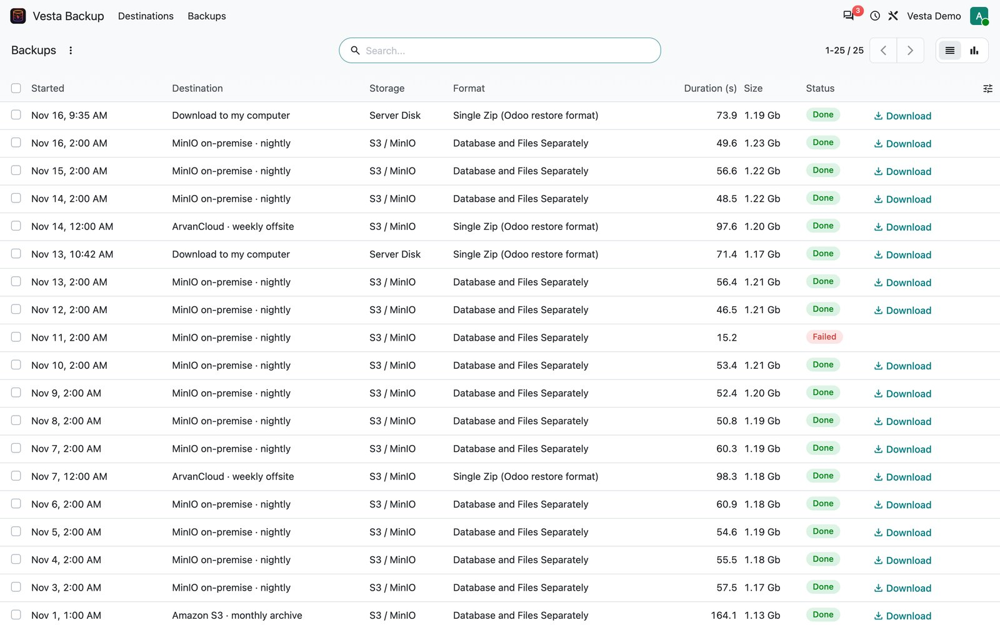</td>
    <td width="50%">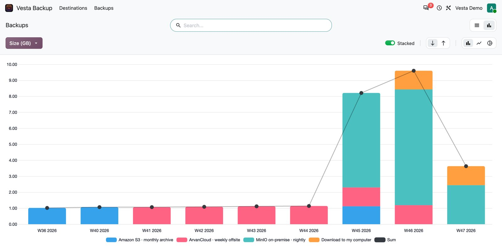</td>
  </tr>
  <tr>
    <td align="center"><b>Every backup, with its status, size and a Download button</b></td>
    <td align="center"><b>Backup volume per week, per destination</b></td>
  </tr>
  <tr>
    <td width="50%">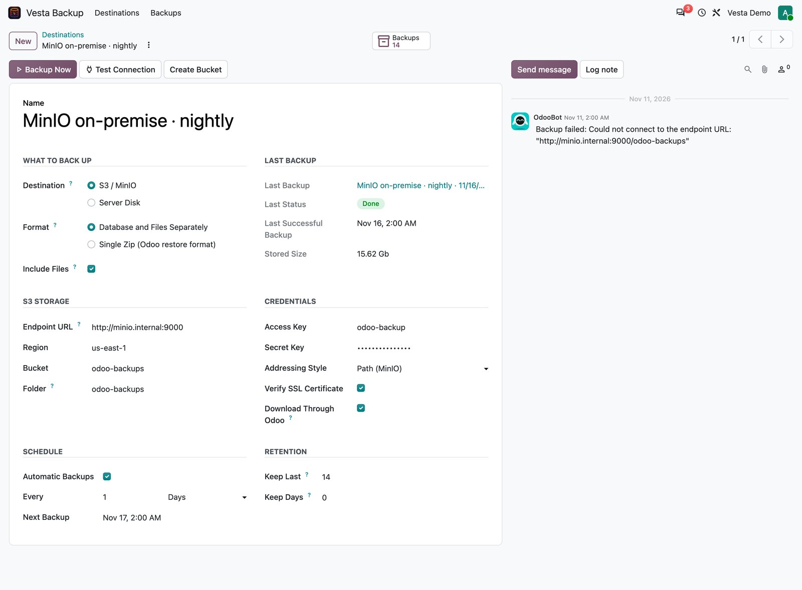</td>
    <td width="50%">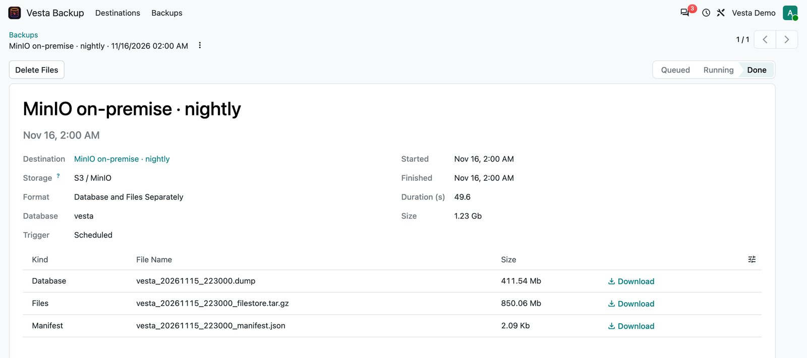</td>
  </tr>
  <tr>
    <td align="center"><b>Test the connection, create the bucket, set the schedule</b></td>
    <td align="center"><b>Database, files and manifest: download each one</b></td>
  </tr>
</table>

<h3 id="quick-start">Quick start</h3>

1. Install the S3 library on the server, add this repository to `addons_path` and install **Vesta Backup**:
   ```bash
   pip install boto3
   ```
2. Open **Vesta Backup → Destinations → New**, choose **S3 / MinIO**, enter the endpoint (empty for Amazon S3,
   `http://minio:9000` for MinIO), bucket and keys, then click **Test Connection** (or **Create Bucket**).
3. Pick a schedule and a retention, save, and click **Backup Now** to see the first backup land.

Just want a copy on your laptop? Open the ready-made **Download to my computer** destination, click
**Backup Now**, then **Download**.

> The server needs a cron thread (`max_cron_threads >= 1`) and a `pg_dump` that matches your PostgreSQL
> version. Backups kept on the server disk go to `<data_dir>/backups/<database>/`, or to the folder set
> with `vesta_backup_dir` in the Odoo configuration file.

<h3 id="restore">Restore</h3>

Separate backup:

```bash
createdb -O odoo newdb
pg_restore --no-owner -d newdb mydb_20261116_223000.dump
mkdir -p <data_dir>/filestore/newdb
tar xzf mydb_20261116_223000_filestore.tar.gz --strip-components=1 -C <data_dir>/filestore/newdb
```

Zip backup: **Restore Database** in `/web/database/manager`, or `odoo db load newdb mydb_20261116_223000.zip`.

### Security

- Only Settings administrators see the app, the destinations and the backups.
- The server-disk folder can only be changed in the server configuration, never from the browser, and
  downloads and deletions are confined to it.
- Secret keys are stored in admin-only fields. Use a dedicated S3 user that can only write to the backup
  bucket.

<h3 id="faq">FAQ</h3>

<details><summary><b>Does it work with Liara, ParsPack, Hamravesh, ArvanCloud or another Iranian object storage?</b></summary>

Yes. Any S3-compatible storage works: set its endpoint, use the *Path* addressing style if it doesn't
support virtual hosts. Vesta Backup turns off the CRC checksums that recent AWS libraries send by default,
which many S3-compatible storages reject.
</details>

<details><summary><b>My MinIO is only reachable from the Odoo server. Can users still download?</b></summary>

Yes. With **Download Through Odoo** (the default) the file is streamed by the Odoo server, so the browser
never talks to MinIO.
</details>

<details><summary><b>How big can the database be?</b></summary>

Backups run in the background, files are written to disk and uploaded in 64 MB parts, so multi-gigabyte
databases and filestores are fine. Keep `limit_time_real_cron` high enough for your largest backup.
</details>

<details><summary><b>Does it back up every database on the server?</b></summary>

Each database backs itself up, with its own destinations. Install the app in every database you want to
protect.
</details>

</div>

---

<div dir="rtl" id="fa">

<p align="center">
  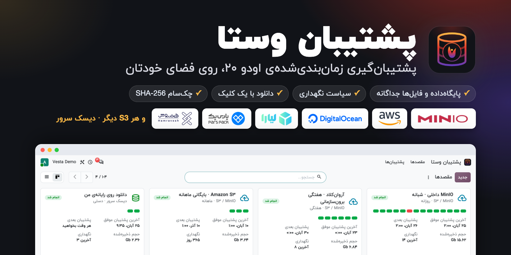
</p>

## دیگر هیچ پایگاه‌داده‌ی اودویی از دست نمی‌رود

**پشتیبان وستا** هر شب، هر هفته یا هر ساعت از پایگاه‌داده‌ی اودو ۲۰ **و** فایل‌هایش پشتیبان می‌گیرد و آن را روی
فضایی می‌گذارد که مال خود شماست: MinIO داخل شبکه‌ی خودتان، لیارا، پارس‌پک، همروش، آروان‌کلاد، AWS،
DigitalOcean یا هر فضای سازگار با S3 دیگر، یا دیسک همان سرور. پشتیبان‌های قدیمی خودکار پاک می‌شوند، هر فایل چک‌سام دارد و هر پشتیبان با یک کلیک روی رایانه‌ی شما دانلود
می‌شود.

بدون اسکریپت cron، بدون SSH، بدون فراموشی. اپ را باز کنید، با یک نگاه ببینید کدام مقصد سالم است و پیش از هر
کار پرخطر **پشتیبان‌گیری الان** را بزنید.

<p align="center">
  <b>سازگار با</b><br><br>
  
</p>

<p align="center">
  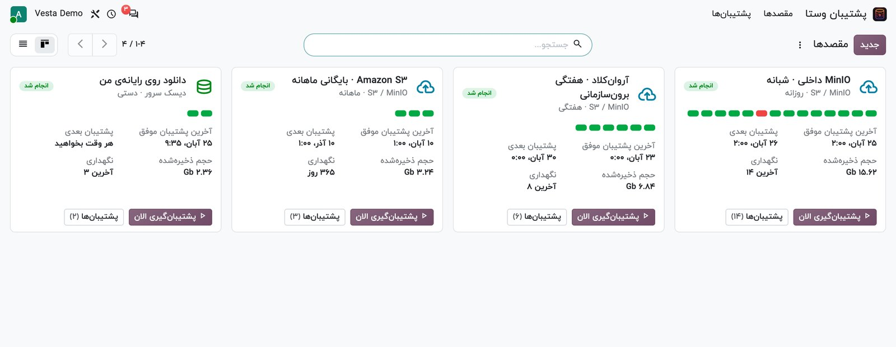
</p>

### چرا پشتیبان وستا؟

- 🗄️ **پایگاه‌داده و فایل‌ها جداگانه**: یک `pg_dump` فشرده (`.dump`)، فایل‌ها به‌صورت `.tar.gz` و یک فایل مشخصات؛ فقط پایگاه‌داده یا فقط پیوست‌ها را برگردانید.
- 📦 **یا یک فایل zip اودو**: همان قالب مدیر پایگاه‌داده‌ی اودو؛ از `/web/database/manager` با دو کلیک بازگردانی می‌شود.
- ☁️ **هر S3، حتی MinIO خودتان**: MinIO، لیارا، پارس‌پک، همروش، آروان‌کلاد، AWS، DigitalOcean Spaces، Cloudflare R2 و هر فضای سازگار با S3 دیگر
- ⏰ **زمان‌بندی جدا برای هر مقصد**: شبانه روی MinIO، هفتگی روی آروان‌کلاد، ماهانه روی S3.
- ♻️ **نگهداری امن**: آخرین N پشتیبان و/یا N روز اخیر؛ آخرین پشتیبان هیچ‌وقت پاک نمی‌شود.
- ⬇️ **دانلود با یک کلیک**: از طریق خود اودو (حتی برای MinIO داخلی) یا با لینک امضاشده‌ی موقت.
- 🧾 **چک‌سام SHA-256** برای هر فایل و آپلود چندبخشی برای فایل‌های بزرگ.
- 🔔 **هشدار خطا**: علامت قرمز روی نوار وضعیت و پیام روی مقصد که برای دنبال‌کنندگان ایمیل می‌شود.
- 🇮🇷 **کاملاً فارسی**: ترجمه‌ی کامل، رابط راست‌به‌چپ و تاریخ شمسی؛ با [فونت وستا](https://github.com/vestaai-ir/vesta-l10n-iran) قلم فارسی هم زیبا می‌شود (همین تصاویر با فونت ایران‌یکان).

<table>
  <tr>
    <td width="50%">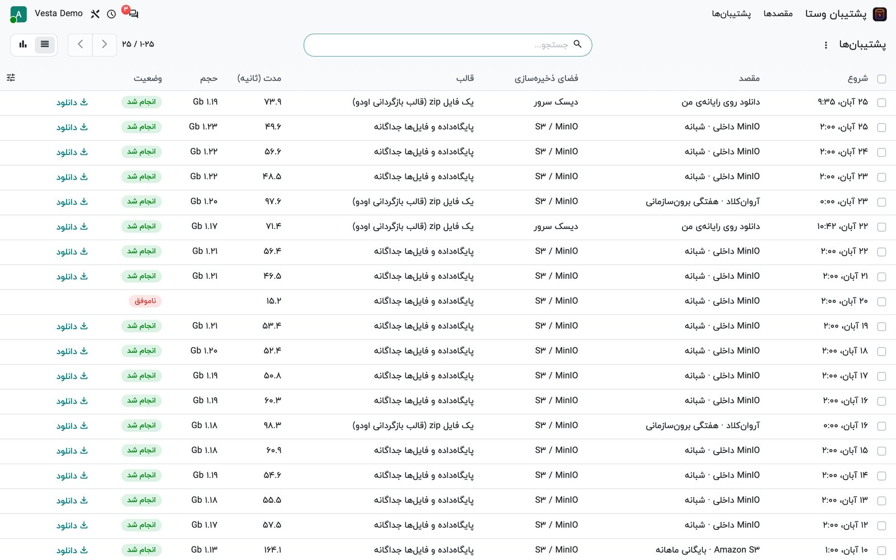</td>
    <td width="50%">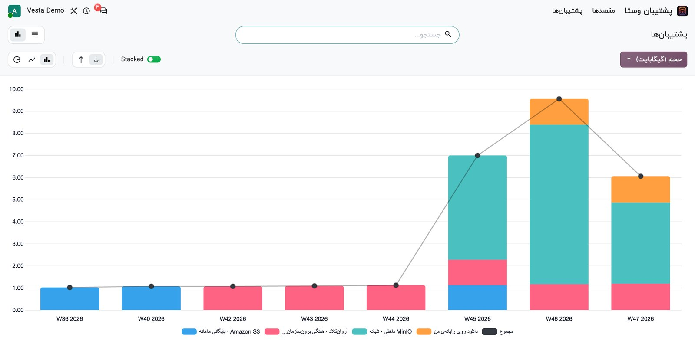</td>
  </tr>
  <tr>
    <td width="50%">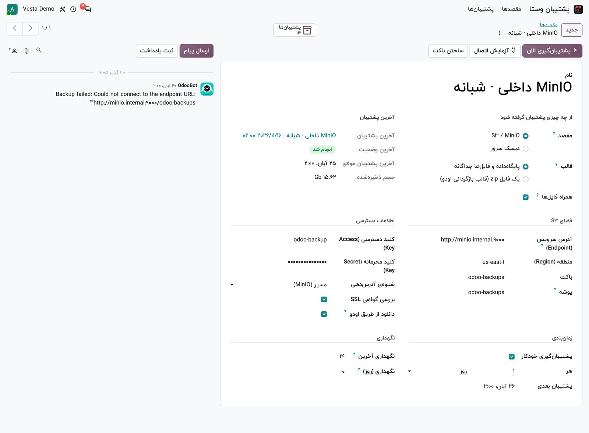</td>
    <td width="50%">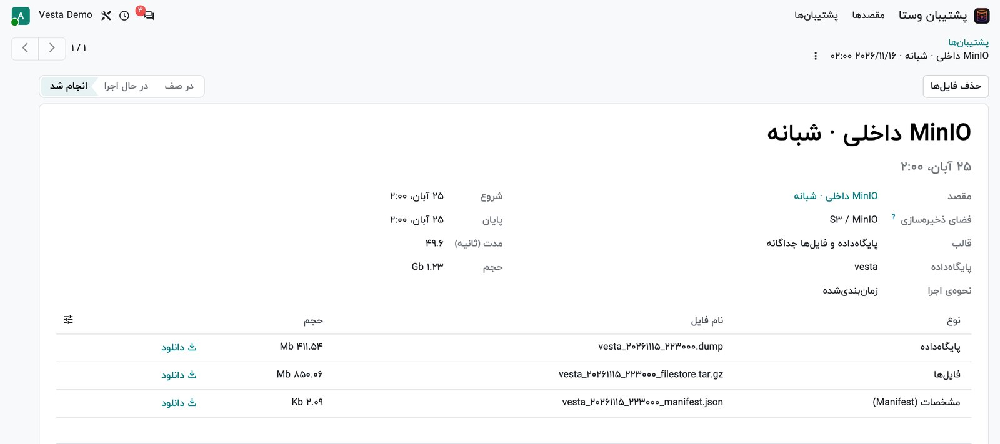</td>
  </tr>
</table>

### راه‌اندازی در سه قدم

1. روی سرور `pip install boto3` را اجرا کنید، این مخزن را به `addons_path` اضافه کنید و **پشتیبان وستا** را نصب کنید.
2. در **پشتیبان وستا ← مقصدها ← جدید**، گزینه‌ی **S3 / MinIO** را انتخاب کنید، آدرس سرویس (برای MinIO مثلاً `http://minio:9000`)، باکت و کلیدها را وارد کنید و **آزمایش اتصال** (یا **ساختن باکت**) را بزنید.
3. زمان‌بندی و نگهداری را تعیین کنید، ذخیره کنید و **پشتیبان‌گیری الان** را بزنید.

فقط یک نسخه روی لپ‌تاپ‌تان می‌خواهید؟ مقصد آماده‌ی **«دانلود روی رایانه‌ی من»** را باز کنید، **پشتیبان‌گیری الان** و بعد **دانلود** را بزنید.

> سرور باید دست‌کم یک رشته‌ی cron داشته باشد (`max_cron_threads >= 1`) و نسخه‌ی `pg_dump` با PostgreSQL جور باشد.
> پشتیبان‌های دیسک سرور در `<data_dir>/backups/<db>/` یا پوشه‌ی گزینه‌ی `vesta_backup_dir` در تنظیمات اودو ذخیره می‌شوند.

دستورهای بازگردانی در بخش [Restore](#restore) آمده است.

</div>

---

### More from Vesta AI · محصولات دیگر وستا

- [Vesta Gateway](https://github.com/vestaai-ir/vesta-payment-iran): Iranian bank payment gateways for Odoo 20 · درگاه پرداخت بانک‌های ایرانی
- [Vesta Font](https://github.com/vestaai-ir/vesta-l10n-iran): Persian fonts for the backend, website, PDF reports and POS · فونت فارسی برای همه‌ی اودو

⭐ If Vesta Backup saved your day, star the repository so others find it. · اگر به کارتان آمد، به مخزن ستاره بدهید.

## License

LGPL-3.0. © 2026 [Vesta AI](https://vestaai.ir)
