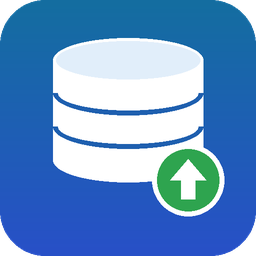

  

<h1 align="center">Vesta Backup · پشتیبان وستا</h1>

  
  
  

<a href="#fa">فارسی</a> · <a href="#en">English</a>

---

## پشتیبان وستا

پشتیبان‌گیری **زمان‌بندی‌شده** از پایگاه‌داده‌ی فعلی و فایل‌های آن، روی هر فضای سازگار با **S3**
(Amazon S3، **MinIO** داخلی، آروان‌کلاد، Cloudflare R2، Wasabi و ...) یا روی **دیسک سرور**، و دانلود هر پشتیبان
به‌صورت فشرده روی رایانه‌ی شخصی با یک کلیک.

### امکانات

- 🗄️ **پایگاه‌داده و فایل‌ها جداگانه**: یک `pg_dump` فشرده (`.dump`) و یک `.tar.gz` از فایل‌ها، همراه با فایل مشخصات
- 📦 یا **یک فایل zip** در قالب مدیر پایگاه‌داده‌ی اودو، قابل بازگردانی از `/web/database/manager`
- ⏰ چند مقصد، هر کدام با **زمان‌بندی** خودش (هر چند ساعت، روز، هفته یا ماه)
- ♻️ **سیاست نگهداری**: نگه داشتن آخرین N پشتیبان و/یا N روز؛ آخرین پشتیبان هیچ‌وقت حذف نمی‌شود
- 🚀 اجرا در پس‌زمینه، آپلود چندبخشی برای فایل‌های بزرگ، **چک‌سام SHA-256** برای هر فایل
- ⬇️ **دانلود** از طریق اودو (برای MinIO داخلی که از بیرون در دسترس نیست) یا با لینک امضاشده‌ی موقت
- 🔔 گزارش خطا در پیام‌های مقصد، تا دنبال‌کنندگان ایمیل بگیرند
- 🔒 فقط مدیر سیستم دسترسی دارد؛ دانلود و حذف فایل‌های دیسک فقط داخل پوشه‌ی پشتیبان مجاز است

### راه‌اندازی

1. روی سرور `pip install boto3` را اجرا کنید و ماژول **Vesta Backup** را نصب کنید.
2. در **پشتیبان وستا > مقصدها** یک مقصد بسازید:
   - **S3 / MinIO**: آدرس سرویس (برای MinIO مثلاً `http://minio:9000`، برای Amazon S3 خالی)، باکت، کلید دسترسی و کلید محرمانه.
     سپس **آزمایش اتصال** یا اگر باکت وجود ندارد **ساختن باکت** را بزنید.
   - **دیسک سرور**: پشتیبان‌ها در `<data_dir>/backups/<db>/` می‌مانند؛ برای پوشه‌ی دیگر (مثلاً NAS) گزینه‌ی
     `vesta_backup_dir` را در فایل تنظیمات اودو بگذارید.
3. زمان‌بندی و نگهداری را تنظیم کنید. سرور باید دست‌کم یک رشته‌ی cron داشته باشد (`max_cron_threads >= 1`).

برای یک پشتیبان سریع، مقصد آماده‌ی **«Download to my computer»** را باز کنید، **پشتیبان‌گیری الان** را بزنید و از فهرست
پشتیبان‌ها **دانلود** کنید.

---

## Vesta Backup

Scheduled backups of the current database and its filestore to any **S3-compatible** storage (Amazon S3, a
self-hosted **MinIO**, ArvanCloud, Cloudflare R2, Wasabi, ...) or to the **server disk**, and one-click compressed
downloads to your own computer.

- **Database and files separately** (compressed `pg_dump` + filestore `.tar.gz` + manifest), or a **single zip**
  in the Odoo database manager format.
- Several destinations, each with its own **schedule** and **retention** (last N backups and/or N days).
- Background runs, multipart uploads, SHA-256 checksums, failure notifications on the destination.
- Downloads streamed through Odoo (works with an internal MinIO) or redirected to a temporary signed URL.
- Restricted to Settings administrators; server-disk downloads and deletions are confined to the backup folder.

See [CONFIGURE](vesta_backup/readme/CONFIGURE.md) and [USAGE](vesta_backup/readme/USAGE.md) (including restore steps).

## License

LGPL-3.0. © 2026 [Vesta AI](https://vestaai.ir)
